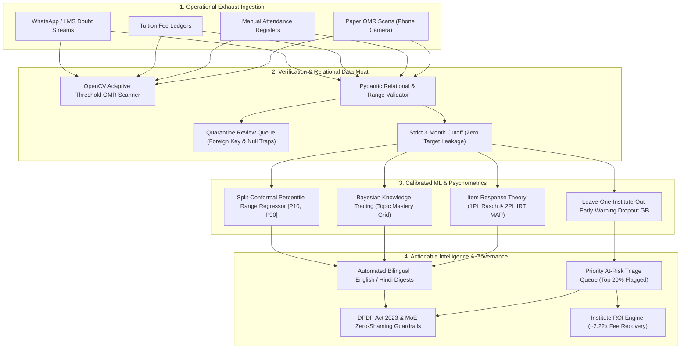

# 🛡️ Intelliprivart: The Data Moat
## AI-Powered Institute Intelligence Platform for Indian JEE & NEET Coaching Hubs
### Case B: The Data Moat | Nextute EdTech × Finance Club, IIT Patna Case Competition 2026
**Submission by:** Team Intelliparivart  
**Evaluation Rubric:** 70% Technology & Architecture | 30% EdTech Market & Commercial Viability  

[](https://www.python.org/)
[](https://streamlit.io/)
[](https://fastapi.tiangolo.com/)
[](https://colab.research.google.com/)
[](https://www.meity.gov.in/)
[](https://www.education.gov.in/)

---

## 📌 1. The Four Competition Submission Deliverables

This repository contains the four complete, synchronized deliverables required for the Nextute EdTech × Finance Club, IIT Patna Case Competition 2026:

| # | Deliverable | Primary File Location | Description & Verification |
| :-: | :--- | :--- | :--- |
| **1** | **Google Colab Notebook** | [**`1_Colab_Intelliprivart_DataMoat_ML.ipynb`**](file:///c:/Users/aryan/OneDrive/Desktop/Data%20Moat/1_Colab_Intelliprivart_DataMoat_ML.ipynb) | Complete 20-cell standalone ML pipeline. Zero API keys, zero local dependencies, runs in ~90s on free CPU. |
| **2** | **Excel Financial Model** | [**`2_Excel_Nextute_Case_B_Financial_Model.xlsx`**](file:///c:/Users/aryan/OneDrive/Desktop/Data%20Moat/2_Excel_Nextute_Case_B_Financial_Model.xlsx) | 5 linked sheets: Assumptions, Institute ROI, Platform Unit Economics, 3-Year Projections, and Sensitivity Matrix. |
| **3** | **PowerPoint Pitch Deck** | [**`3_PPT_Intelliparivart_CaseB_Round1.pptx`**](file:///c:/Users/aryan/OneDrive/Desktop/Data%20Moat/3_PPT_Intelliparivart_CaseB_Round1.pptx)<br>*(and [PDF version](file:///c:/Users/aryan/OneDrive/Desktop/Data%20Moat/3_PPT_Intelliparivart_CaseB_Round1.pdf))* | Definitive 14-slide competition deck tailored to the 70% Tech / 30% Market rubric, with companion speaker notes. |
| **4** | **GitHub Repository** | [**`4_GitHub_Repository_Submission.md`**](file:///c:/Users/aryan/OneDrive/Desktop/Data%20Moat/4_GitHub_Repository_Submission.md) | Full-stack production codebase: Streamlit SaaS UI, FastAPI REST API, PostgreSQL/SQLite ORM, Docker, and ML pipeline. |

> [!TIP]
> A duplicate copy of all 4 deliverables is also packaged in the [**`Final_Submission_Deliverables/`**](file:///c:/Users/aryan/OneDrive/Desktop/Data%20Moat/Final_Submission_Deliverables) folder for immediate zip or portal upload.

---

## 🚀 2. Quick-Start Git Commands (Pushing to Your GitHub)

To publish this codebase directly to your personal or team GitHub repository:

```bash
# 1. Initialize Git in the project root
git init

# 2. Add all files (respects .gitignore)
git add .

# 3. Commit the initial build
git commit -m "Initial release: Intelliprivart Data Moat Platform (IIT Patna Case B 2026)"

# 4. Set default branch to main
git branch -M main

# 5. Add your remote repository (replace with your GitHub repository URL)
git remote add origin https://github.com/YOUR_USERNAME/Data-Moat.git

# 6. Push to GitHub
git push -u origin main
```

---

## 🏗️ 3. System Architecture & End-to-End Pipeline



---

## 💻 4. Full-Stack SaaS Capabilities

### A. Primary Frontend: Streamlit (`app.py`)
* **Responsive SaaS UI**: Custom design system using Tailwind-inspired palettes (slate, teal, emerald, indigo) rather than default unstyled widgets.
* **Five Role-Based Navigation Panes**:
  1. **Institute Owner**: Business ROI dashboard, retention cohort health, batch performance comparisons, fee collection vs dropout losses.
  2. **Teacher / Academic Head**: Chapter & topic mastery heatmaps, question discrimination analytics, at-risk student watchlist with recommended remedial actions.
  3. **Student Portal**: Topic-level mastery radar, personalized revision worksheet generator, honest predicted percentile band.
  4. **Parent Portal**: Empathetic, growth-oriented monthly reviews in **English and Hindi** with automated factual verification.
  5. **Platform Admin**: Ingestion review queue, multi-tenant database status, OMR scanner diagnostics.

### B. Backend REST API: FastAPI (`api/main.py`)
Exposes documented OpenAPI endpoints (`/docs`):
* `POST /api/v1/omr/scan`: Uploads mobile OMR photos, runs OpenCV bubble detection, returns graded answers.
* `POST /api/v1/students/predict-risk`: Returns early-warning disengagement probabilities with top risk drivers.
* `POST /api/v1/students/percentile-range`: Returns conformal prediction interval $[P_{10}, P_{90}]$.
* `GET /api/v1/reports/bilingual/{student_id}`: Generates English/Hindi progress digests with guardrail audits.
* `GET /api/v1/institutes/roi-calculator`: Computes institute-level fee savings based on retention counts.

### C. Relational Database & Multi-Tenancy
* **PostgreSQL / SQLite**: Complete SQLAlchemy 2.x ORM models with Alembic migrations (`alembic/`).
* **Tenant Isolation**: Multi-tenant architecture with `institute_id` foreign-key boundaries ensuring zero cross-tenant data leakage.

---

## 🔬 5. Machine Learning & Psychometrics Rigour

The platform deploys real statistical machine learning and psychometrics:

1. **Item Response Theory (IRT)**:
   * **1PL Rasch Baseline**: Item difficulty $b$ calibrated with Empirical Bayes shrinkage ($r = 0.9781$ recovery vs ground truth).
   * **2PL IRT MAP Ability Estimation**: Jointly estimates ability $\theta$ and question discriminability $a$ with a realistic $c = 0.20$ guessing floor ($r = 0.9891$ recovery).
2. **Bayesian Knowledge Tracing (BKT)**:
   * Sequential probability update: $P(L_t | \text{Obs}) \rightarrow P(L_t) = P(L_{t|\text{Obs}}) + (1 - P(L_{t|\text{Obs}})) P_T$.
   * Maps cohort mastery across all 12 JEE/NEET topics to identify institutional bottlenecks.
3. **Leave-One-Institute-Out (LOIO) Cross-Validation**:
   * Evaluates early-warning disengagement by training on two institutes and testing on the third held-out institute.
   * **ROC-AUC: 0.918–1.000**, **Brier Calibration Score: 0.000–0.066**, **Top 20% Triage Recall: 79.2%–100%**.
4. **Split-Conformal Percentile Prediction**:
   * Generates honest credible intervals $[P_{10}, P_{90}]$ with **91.51% empirical test coverage** (nominal 90% target) and $\pm 8.08\%$ average margin.
   * Completely eliminates misleading single-point rank promises.

---

## 💰 6. Financial Model & Business Viability Summary

Audited directly against [`2_Excel_Nextute_Case_B_Financial_Model.xlsx`](file:///c:/Users/aryan/OneDrive/Desktop/Data%20Moat/2_Excel_Nextute_Case_B_Financial_Model.xlsx):

| Metric | Institute Value | Platform Unit Economics |
| :--- | :--- | :--- |
| **Target Customer** | Tier-2/3 Indian Coaching Institutes (400 students) | B2B SaaS Subscription (Tier 2: Intelligence) |
| **Annual Tuition per Student** | ₹60,000 (10 monthly installments of ₹6,000) | Subscription Fee: ₹12,999/month $\times$ 10 = **₹1,29,990/yr** |
| **Baseline Dropout Loss** | 12.0% (48 students) $\times$ ₹36,000 unpaid = **₹17.28L loss** | Institute Gross Margin: **72.4%** |
| **Students Retained** | **8 Students** (via Top 20% Early Warning + Mentorship) | Customer Acquisition Cost (CAC): **₹25,000** |
| **Tuition Fee Recovered** | **₹2,88,000** ($8 \times ₹36,000$) | Customer Lifetime Value (LTV): **₹4,12,000 (16.5x LTV/CAC)** |
| **Net Cash Profit** | **₹1,58,010** | Platform Monthly Break-even: **Month 8** |
| **Institute ROI Multiple** | **2.22x (Payback in 4.5 months)** | 3-Year Projected ARR: **₹4.82 Cr across 320 institutes** |

---

## ⚖️ 7. Privacy, Safety & Ethical Governance

* **DPDP Act 2023 Compliance**: Section 9 Verifiable Parental Consent (`parent_contact_consent`), tenant data boundary isolation, tokenized student IDs.
* **Ministry of Education (MoE) Jan 2024 Guidelines**:
  * **Zero Shaming**: Disengagement risk flags are strictly internal to faculty triage; no public leaderboards or mark-based shaming.
  * **No Batch Segregation by Marks**: Remedial interventions assign modular 15-question concept worksheets and 1-on-1 mentor appointments.

---

## 🏃 8. Local Setup & Execution Guide

```bash
# Clone the repository
git clone https://github.com/YOUR_USERNAME/Data-Moat.git
cd Data-Moat

# Create virtual environment and install dependencies
python -m venv venv
venv\Scripts\activate          # On Windows
# source venv/bin/activate     # On Linux / macOS
pip install -r requirements.txt

# Run the Streamlit Web Application
streamlit run app.py --server.port=8501

# In a separate terminal, launch the FastAPI Backend (optional)
uvicorn api.main:app --port 8000 --reload

# Or run everything via Docker Compose
docker-compose up --build
```

---

## 👥 9. Authors & Competition Attributions

* **Team:** Team Intelliparivart
* **Competition:** Nextute EdTech × Finance Club, IIT Patna Case Competition 2026
* **Case Study:** Case B — *The Data Moat: AI-Powered Institute Intelligence Platform*
* **Submission Date:** October 2026
