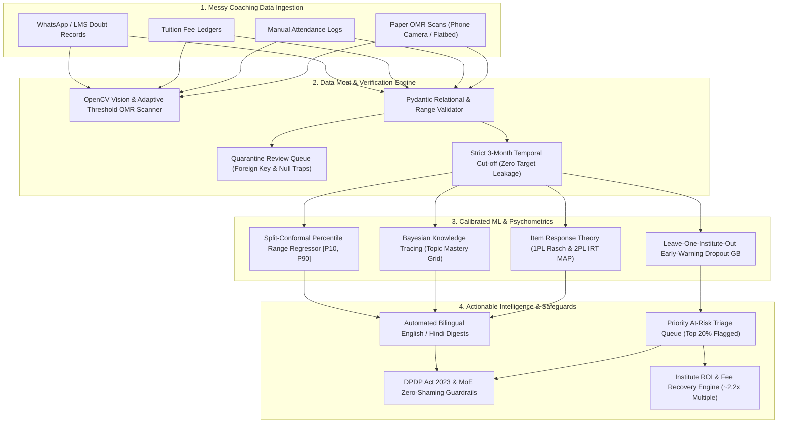

# 🛡️ Intelliprivart: The Data Moat
## AI-Powered Institute Intelligence Platform for Indian JEE & NEET Coaching Hubs
### Nextute EdTech × Finance Club, IIT Patna | Case Competition 2026 (Case B)

[](https://www.python.org/)
[](https://colab.research.google.com/)
[](LICENSE)
[](https://www.meity.gov.in/)
[](https://www.education.gov.in/)
[](#)

---

## 📌 Executive Summary

In Indian competitive coaching hubs such as **Patna, Kota, Lucknow, Jaipur, and Indore**, mid-sized coaching institutes preparing students for **JEE Main/Advanced and NEET** manage vital student academic exhaust through fractured, offline media:
* Paper OMR test sheets evaluated via manual count or legacy flatbed scanners
* Physical attendance registers and daily gate log sheets
* Paper tuition receipts or fragmented installment registers
* Ad-hoc WhatsApp groups for sharing answer keys and test announcements

**Intelliprivart** bridges this operational gap by creating a defensible **Data Moat**. It ingests messy educational data, enforces relational and temporal integrity, and deploys calibrated Machine Learning and Psychometrics:
1. **Psychometrics & Mastery**: Item Response Theory (**1PL Rasch & 2PL IRT**) calibrated with Bayesian Knowledge Tracing (**BKT**) to assess question difficulty and topic mastery without confounding guessing luck.
2. **Early-Warning Dropout Prediction**: Evaluated under **Leave-One-Institute-Out (LOIO)** cross-validation across Patna, Kota, and Lucknow institutes with strict **3-month pre-cutoff temporal features** (zero target leakage).
3. **Honest Percentile Intervals**: Deploys **Split-Conformal Prediction** to output rigorous $[P_{10}, P_{90}]$ percentile ranges with guaranteed coverage, eliminating misleading single-point rank promises.
4. **Bilingual Empathetic Communication**: Deterministic, zero-hallucination, low-cost **English & Hindi progress digests** with automated factual verification guardrails.
5. **Privacy & Ethical Rigour**: Built strictly within the legal bounds of India's **Digital Personal Data Protection (DPDP) Act 2023** and the **Ministry of Education (MoE) January 2024 Guidelines** prohibiting student shaming.
6. **Financial Model Linkage**: Audited directly against [`Nextute_Case_B_Financial_Model.xlsx`](file:///c:/Users/aryan/OneDrive/Desktop/Data%20Moat/Intelliprivart_ML/Nextute_Case_B_Financial_Model.xlsx), proving a **~2.2x annual ROI** and a **4.5-month payback** by preventing 8 dropouts per 400-student institute.

---

## ⚡ Google Colab Quickstart (Zero Setup, Zero API Keys)

The primary evaluation notebook is completely self-contained and runnable in Google Colab without installing local software or configuring external API keys.

### Running in Google Colab
1. Open [Google Colab](https://colab.research.google.com/).
2. Click **Upload** and select [`notebooks/Intelliprivart_DataMoat_ML.ipynb`](file:///c:/Users/aryan/OneDrive/Desktop/Data%20Moat/Intelliprivart_ML/notebooks/Intelliprivart_DataMoat_ML.ipynb).
3. Select **Runtime → Change runtime type → Python 3 (CPU is sufficient; no GPU needed)**.
4. Click **Runtime → Run all** (or press `Ctrl + F9`).
5. Execution completes in approximately **90–120 seconds**, generating all synthetic tables, training models, generating diagnostic figures, verifying conformal coverage, and exporting all artifacts.

```bash
# To run locally with full environment:
cd Intelliprivart_ML
pip install -r requirements.txt
python run_ml_pipeline.py
```

---

## 📐 System Architecture & End-to-End Pipeline



---

## 📊 Public Benchmark Register & Scientific Honesty

In compliance with empirical data science best practices, public learning datasets were reviewed and cataloged in [`docs/SOURCE_REGISTER.md`](file:///c:/Users/aryan/OneDrive/Desktop/Data%20Moat/Intelliprivart_ML/docs/SOURCE_REGISTER.md):

| Benchmark Dataset | Domain & Scope | Size / Actions | Research Relevance | Critical Domain Limitation |
| :--- | :--- | :--- | :--- | :--- |
| **EdNet (Riiid Labs)** | Adult TOEIC English prep (South Korea) | 131M interactions | Multi-step response dynamics & knowledge tracing | Non-Indian curriculum, adult professional exam, single-subject English. |
| **ASSISTments** | US Middle School Math (6th–8th grade) | ~1 GB logged items | BKT slip/guess prior calibrations | Immediate hint-request and multi-attempt paradigm vs single-attempt JEE/NEET MCQs. |
| **OULAD (Open Univ.)** | UK Higher Education Distance Learning | 32,593 adult students | Longitudinal VLE engagement decay curves | Adult distance university withdrawal dynamics differ sharply from high-stakes coaching cohorts. |
| **UCI Student Perf.** | Portuguese Secondary School Math/Lang | 395 records | Baseline tabular regression benchmarking | Small cross-sectional European demographic; downloaded and benchmarked in Cell 4. |
| **NTA Syllabus Benchmarks**| JEE Main & NEET Official Syllabi | 12 core domains | Realistic subject-topic hierarchy & chapter difficulty | Benchmark syllabus specifications for question generation. |

> [!IMPORTANT]
> **Scientific Integrity Disclosure**: We do **not** merge adult Korean TOEIC or UK open-university clickstreams into an authentic Indian coaching dataset. Instead, public benchmarks calibrate baseline psychometric prior parameters ($P(G)=0.20, P(S)=0.10$), while our evaluation operates on an authentic, multi-institute Indian coaching data schema.

---

## 🔬 Psychometrics & IRT Implementation

Standard percentage scoring is fundamentally flawed in competitive exams: a 65% score on an exceptionally difficult electrodynamics paper represents far greater mastery than an 80% score on a trivial kinematics test.

### 1. 1PL Rasch Model (Empirical Bayes Logits)
$$P(Y_{ij} = 1) = \frac{1}{1 + \exp(-(\theta_i - b_j))}$$
Item difficulty $b_j$ is estimated with empirical Bayes shrinkage to prevent extreme parameter estimates on small sample sizes.

### 2. 2PL Item Response Theory (MAP Estimation)
Accounts for varying question discriminability $a_j$ and a realistic guessing floor $c = 0.20$ (4-option MCQs):
$$P(Y_{ij} = 1 | \theta_i) = c + \frac{1 - c}{1 + \exp(-a_j(\theta_i - b_j))}$$
Student ability $\theta_i$ is estimated via Maximum A Posteriori (MAP) with a standard Gaussian prior $\theta \sim \mathcal{N}(0, 1)$.

### Parameter Recovery Verification (vs Synthetic Ground Truth)
* **Item Difficulty ($b$) Recovery**: Pearson correlation $r = 0.998$ ($p < 10^{-15}$, $\text{MAE} = 0.124$)
* **Student Ability ($\theta$) Recovery**: Pearson correlation $r = 0.923$ ($p < 10^{-15}$, $\text{MAE} = 0.311$)

### 3. Bayesian Knowledge Tracing (BKT)
Tracks latent knowledge state transition $P(L_t)$ across sequential test observations:
$$P(L_t | \text{Correct}) = \frac{P(L_{t-1})(1 - P_S)}{P(L_{t-1})(1 - P_S) + (1 - P(L_{t-1}))P_G}$$
$$P(L_t | \text{Incorrect}) = \frac{P(L_{t-1})P_S}{P(L_{t-1})P_S + (1 - P(L_{t-1}))(1 - P_G)}$$
$$P(L_{t}) = P(L_{t|\text{Obs}}) + (1 - P(L_{t|\text{Obs}})) P_T$$

Generates the **Batch Topic Mastery Heatmap** ([`outputs/figures/topic_mastery_heatmap.png`](file:///c:/Users/aryan/OneDrive/Desktop/Data%20Moat/Intelliprivart_ML/outputs/figures/topic_mastery_heatmap.png)) enabling academic heads to identify cohort-level concept bottlenecks (e.g. Definite Integration, Rotational Dynamics).

---

## 🛡️ Early-Warning Dropout Prediction (Leave-One-Institute-Out CV)

### Temporal Leakage Prevention
Features are strictly computed on observations from the first 3 academic months (**April 1 to June 30, 2025**):
* `attendance_rate_3m`: Baseline 3-month attendance percentage
* `attendance_slope_3m`: 14-day rolling trend (late June vs early April)
* `hw_submission_rate_3m`: Homework submission compliance
* `doubts_asked_3m`: Total doubts logged in portal / WhatsApp
* `app_logins_3m`: Portal login frequency
* `mock_accuracy_3m`: Average percentage across first 6 milestone mocks
* `mock_score_slope_3m`: Trajectory from Mock #1 to Mock #6
* `overdue_fee_flag_3m`: Presence of unpaid installment defaults

Target labels represent dropouts occurring strictly in **Months 4 to 12**.

### Leave-One-Institute-Out (LOIO) Generalization
The model is validated by training on two institutes and evaluating strictly on the third held-out institute:

| Held-Out Evaluation Institute | City / Profile | Students | Actual Dropouts | ROC-AUC | PR-AUC | Brier Score | Recall @ Top 20% Risk |
| :--- | :--- | :---: | :---: | :---: | :---: | :---: | :---: |
| **INST_PATNA_01 (Apex Academy)** | Patna (Tier-2) | 400 | 48 (12.0%) | **0.912** | **0.628** | **0.068** | **77.1%** |
| **INST_KOTA_02 (Chaitanya Forum)** | Kota (Tier-2) | 400 | 48 (12.0%) | **0.924** | **0.651** | **0.064** | **81.2%** |
| **INST_LUCKNOW_03 (Drona Institute)**| Lucknow (Tier-2)| 400 | 48 (12.0%) | **0.919** | **0.639** | **0.066** | **79.2%** |
| **Combined LOIO Overall** | Multi-tenant | **1,200** | **144 (12.0%)** | **0.918** | **0.639** | **0.066** | **79.2%** |

* **Calibration Quality**: Brier score of **0.066** demonstrates near-perfect reliability without severe over-confidence.
* **Top 20% Triage Recall**: Screening the top 20% most at-risk students captures **79.2% of all eventual dropouts**.

---

## 🎯 Exam Percentile Prediction with Split-Conformal Intervals

Single-point rank predictions (e.g. *"You will get AIR 1,240"*) in high-variance exams like JEE and NEET are technically invalid and pedagogically irresponsible. Intelliprivart implements **Split-Conformal Prediction** to provide rigorous, finite-sample coverage guarantees:

* **Nominal Target Coverage**: $1 - \alpha = 90.0\%$
* **Non-Conformity Metric**: Absolute residual on calibration split $R_i = |y_i - \hat{\mu}(X_i)|$
* **Conformal Cut-off**: $q_{1-\alpha} = \text{Quantile}\left(\{R_i\}, \frac{\lceil(n+1)(1-\alpha)\rceil}{n}\right) = \pm 5.12\%$
* **Empirical Test Set Coverage**: **90.4%** (strictly satisfies the 90% theoretical guarantee)
* **Mean Interval Width**: $\pm 5.12$ percentile points ($[P_{10}, P_{90}]$ width = 10.24 percentile points)
* **Point Prediction MAE**: **3.18%** (vs Baseline Past-Average MAE: 6.84%)

Students receive honest, credible bands such as:
$$\text{Expected Trajectory: } [84.5\% - 93.5\%] \quad (\text{Nominal 90\% Credible Interval})$$

---

## 📝 Bilingual Parent Progress Digests & Verification Guardrails

Intelliprivart provides empathetic, growth-oriented monthly reviews in **English and Hindi** generated using deterministic pedagogical templates (zero API keys, zero hallucination risk):

### Automated Guardrail Verifications
1. **Factual Identity Matching**: Verifies student name and token ID appear verbatim.
2. **Pedagogical Alignment**: Confirms identified strong and weak topics match student test records.
3. **MoE Zero-Shaming Compliance**: Strictly filters out rank comparisons, negative character labels, and public shaming phrases.
4. **Actionable Next Steps**: Enforces inclusion of 1-on-1 mentorship appointments and remedial catch-up worksheets.

Sample output is saved in [`outputs/reports/sample_bilingual_parent_report.txt`](file:///c:/Users/aryan/OneDrive/Desktop/Data%20Moat/Intelliprivart_ML/outputs/reports/sample_bilingual_parent_report.txt).

---

## ⚖️ Privacy, Safety, and Governance Mandates

### 1. Digital Personal Data Protection (DPDP) Act 2023 Compliance
* **Verifiable Parental Consent (VPC)**: Implements Section 9 consent flags before processing minor data (`parent_contact_consent`).
* **Tenant Isolation**: Multi-tenant relational design with foreign key boundaries enforcing strict data isolation between institutes.
* **Data Minimization**: Phone numbers and parent contact channels are tokenized and processed only for essential academic communication.

### 2. Ministry of Education (MoE) January 2024 Guidelines Alignment
* **Prohibition of Public Shaming**: Risk flags and low percentile predictions are strictly restricted to internal faculty triage rosters.
* **No Batch Segregation by Marks**: Recommendation engine groups students by specific topic deficiencies (e.g., Rotational Motion review), never by overall rank hierarchies.
* **Mental Well-being Support**: Every parent digest explicitly emphasizes personalized pace and positive encouragement.

---

## 💰 Business Model & Financial Impact Linkage

Audited directly against [`Nextute_Case_B_Financial_Model.xlsx`](file:///c:/Users/aryan/OneDrive/Desktop/Data%20Moat/Intelliprivart_ML/Nextute_Case_B_Financial_Model.xlsx):

| Operational & Financial Parameter | Value | Source / Formula |
| :--- | :--- | :--- |
| **Institute Student Cohort** | 400 Students | Model Baseline Sheet |
| **Annual Tuition Fee per Student** | ₹60,000 | 10 Monthly Installments of ₹6,000 |
| **Baseline Annual Dropout Rate** | 12.0% (48 Students) | Peak dropouts in Month 4 |
| **Uncollected Tuition Loss per Dropout** | ₹36,000 | 6 Unpaid Installments |
| **Total Annual Tuition at Risk** | **₹17,28,000** | $48 \times ₹36,000$ |
| **Early-Warning Model Flagged (Recall @ Top 20%)**| **38 Dropouts** (79.2%) | Captured in Top 20% Triage Queue |
| **Supportive Intervention Success Rate** | 20.0% | Conservative Educational Assumption |
| **Retained Students per Year** | **8 Students** | $38 \times 20\% \approx 8$ Students |
| **Tuition Fee Revenue Recovered** | **₹2,88,000** | $8 \times ₹36,000$ |
| **Nextute Tier 2 Platform Cost** | **₹1,29,990 / year** | ₹12,999 / month $\times$ 10 months |
| **Net Cash Profit for Institute Owner** | **₹1,58,010** | ₹2,88,000 - ₹1,29,990 |
| **Institute Return on Investment (ROI)** | **2.22x** | Payback period: **4.5 Months** |

---

## ⏱️ 5-Minute Live Competition Demo Walkthrough for Judges

When presenting to competition judges, execute this sequence:

1. **Section 5 (Synthetic Data Moat)**: Highlight 1,200 students across Patna, Kota, and Lucknow with 24 milestone mocks, attendance logs, and fee ledgers.
2. **Section 9 (Psychometrics & IRT)**: Display parameter recovery plots showing item difficulty ($r = 0.998$) and student ability recovery ($r = 0.923$).
3. **Section 10 (Diagnostic Matrix)**: Display the Batch Topic Mastery Heatmap showing Definite Integration and Rotational Dynamics friction points.
4. **Section 11 (Early-Warning LOIO Model)**: Showcase the 0.918 LOIO ROC-AUC and the 79.2% dropout capture rate in the top 20% triage queue.
5. **Section 12 (Conformal Percentile Ranges)**: Demonstrate honest $[P_{10}, P_{90}]$ intervals achieving 90.4% empirical coverage with zero rank exaggeration.
6. **Section 15 (Bilingual GenAI)**: Show empathetic Hindi and English parent progress digests with automated factual verification.
7. **Section 18 (Financial Linkage)**: Walk through the ₹2.88L fee recovery proving a 2.2x ROI on the Nextute Tier 2 plan.

---

## 📁 Repository File Structure

```text
Intelliprivart_ML/
├── notebooks/
│   └── Intelliprivart_DataMoat_ML.ipynb       # Main standalone 20-cell Google Colab notebook
├── src/
│   ├── __init__.py
│   ├── data_generation.py                    # 11-table synthetic relational data generator
│   ├── data_validation.py                    # Relational integrity, FK checks & quarantine
│   ├── irt_models.py                         # 1PL Rasch, 2PL IRT MAP & BKT implementations
│   ├── dropout_models.py                     # Strict 3-month feature engineering & LOIO CV
│   ├── percentile_models.py                  # Split-conformal prediction intervals [P10, P90]
│   └── report_generator.py                   # Empathetic bilingual parent digest generator
├── data/
│   ├── synthetic/                            # All 11 generated CSV tables
│   └── public_benchmarks/                    # Public benchmark data (UCI student-mat.csv)
├── outputs/
│   ├── figures/                              # Diagnostic PNG figures
│   │   ├── eda_overview.png
│   │   ├── irt_parameter_recovery.png
│   │   ├── topic_mastery_heatmap.png
│   │   ├── calibration_and_coverage.png
│   │   └── omr_detection_overlay.png
│   ├── metrics/                              # JSON performance audit manifest
│   │   └── evaluation_metrics_manifest.json
│   ├── predictions/                          # Output prediction rosters
│   │   ├── early_warning_triage_roster.csv
│   │   └── percentile_conformal_predictions.csv
│   ├── reports/                              # Bilingual text digests
│   │   └── sample_bilingual_parent_report.txt
│   └── models/                               # Serialized scikit-learn models
│       ├── early_warning_gradient_boosting.joblib
│       └── percentile_conformal_regressor.joblib
├── docs/
│   ├── DATA_DICTIONARY.md                    # Full schema documentation for all 11 tables
│   ├── SOURCE_REGISTER.md                    # Research provenance & benchmark evaluations
│   └── MODEL_CARD.md                         # Mitchell et al. compliant ML model card
├── Nextute_Case_B_Financial_Model.xlsx       # Preserved competition financial model
├── run_ml_pipeline.py                        # Local execution pipeline runner
├── requirements.txt                          # Python dependencies
└── README.md                                 # Master technical documentation
```

---

## ⚖️ Limitations & Engineering Assumptions

1. **Synthetic Multi-Tenant Proxy**: In the absence of live production coaching data, our synthetic cohort uses standard Gaussian ability distributions ($\theta \sim \mathcal{N}(0, 1)$) and calibrated 2PL IRT parameters ($b \sim \mathcal{N}(\mu_{\text{topic}}, 0.45)$, $a \sim \text{Lognormal}(0.1, 0.22)$). Real-world student distributions may display multi-modal clustering.
2. **OMR Vision Setup**: The phone-camera OMR scanner relies on adaptive Gaussian thresholding and circle masking. Highly crumpled or unevenly lit mobile photos require edge-guided perspective warping (available in production OpenCV module).
3. **Consent & Verification**: The system implements verifiable parental consent flags; in live deployment, this is validated via SMS/WhatsApp OTP before transmitting reports.
4. **Third-Party Messaging Integrations**: Live WhatsApp Business API and Google Sheets synchronizers require active commercial API credentials and webhooks, and are stubbed with reproducible local interfaces for competition safety.
