# 🗄️ Database Schema & Data Dictionary
**Platform:** Intelliprivart — AI-Powered Institute Intelligence Platform  
**Architecture:** Normalized Multi-Tenant Relational Schema (PostgreSQL / SQLite via SQLAlchemy 2.x & Alembic)  
**Standard:** ISO/IEC 11179 Compliant Metadata  

---

## 1. Entity-Relationship Diagram (ERD)

```mermaid
erDiagram
    institutes ||--o{ batches : "has"
    institutes ||--o{ students : "enrolls"
    institutes ||--o{ profiles : "employs"
    institutes ||--o{ tests : "conducts"
    institutes ||--o{ interventions : "manages"
    institutes ||--o{ imports : "tracks"
    institutes ||--o{ audit_logs : "records"

    batches ||--o{ students : "contains"
    batches ||--o{ tests : "assigned_to"

    syllabus_topics ||--o{ questions : "categorizes"
    questions ||--o{ test_responses : "attempted_in"
    tests ||--o{ test_responses : "contains"

    students ||--o{ test_responses : "submits"
    students ||--o{ attendance : "logs"
    students ||--o{ fees : "pays"
    students ||--o{ engagement : "exhibits"
    students ||--o{ model_predictions : "receives"
    students ||--o{ interventions : "targeted_for"

    institutes {
        string id PK "e.g. INST_PATNA_01"
        string name "Apex JEE & Medical Academy"
        string city "Patna"
        string city_tier "Tier-2"
        string exam_focus "JEE/NEET"
        string subscription_plan "Tier 2: Intelligence"
        float annual_fee_per_student "60000.0"
        datetime created_at
    }

    profiles {
        string id PK
        string user_id "Auth provider UUID"
        string institute_id FK
        string display_name
        string role "Admin, Owner, Teacher, Student, Parent"
        string account_status "ACTIVE"
    }

    batches {
        string id PK
        string institute_id FK
        string name "12th JEE Achievers Top-30"
        string class_level "12th"
        string target_exam "JEE Advanced"
        string faculty_lead
    }

    students {
        string id PK "e.g. STD_PATNA_001"
        string institute_id FK
        string batch_id FK
        string pseudonymous_code "Tokenized Identifier"
        string name "Aditya Shah"
        string class_level "12th"
        date join_date
        boolean parent_contact_consent "DPDP Act VPC flag"
        float latent_ability_theta
    }

    syllabus_topics {
        string id PK "TOP_01 to TOP_12"
        string subject "Physics, Chemistry, Mathematics, Biology"
        string chapter "Mechanics, Calculus, Organic"
        string topic "Kinematics, Definite Integration"
        string exam_focus "JEE/NEET"
        float difficulty_center
    }

    questions {
        string id PK "Q_001 to Q_300"
        string institute_id FK "Nullable for national bank"
        string topic_id FK
        string subject
        float difficulty_b "IRT difficulty estimate"
        float discrimination_a "IRT discrimination"
        string correct_option "Option_A to Option_D"
        string tagging_status "VERIFIED"
    }

    tests {
        string id PK "TEST_01"
        string institute_id FK
        string batch_id FK
        string title "Milestone Mock #01"
        date test_date
        integer academic_month
        integer total_questions "20"
        float max_score "80.0"
        string exam_type "JEE Main / NEET"
    }

    test_responses {
        string id PK
        string test_id FK
        string student_id FK
        string question_id FK
        string response "Option_A"
        integer is_correct "0 or 1"
        integer time_taken_sec
        datetime created_at
    }

    attendance {
        string id PK
        string institute_id FK
        string student_id FK
        date session_date
        integer present_flag "0 or 1"
    }

    fees {
        string id PK
        string institute_id FK
        string student_id FK
        integer instalment_no "1 to 10"
        date due_date
        date paid_date "Nullable if defaulted"
        float amount "6000.0"
        string payment_status "PAID / DEFAULTED"
    }

    engagement {
        string id PK
        string institute_id FK
        string student_id FK
        date activity_date
        integer doubts_asked
        integer homework_submitted "0 or 1"
        integer app_logins
    }

    model_predictions {
        string id PK
        string institute_id FK
        string student_id FK
        string model_name "Dropout_GB / Conformal_Regressor"
        string model_version "v1.0"
        string prediction_type "RISK_PROB / PERCENTILE_INTERVAL"
        float prediction_value "0.85 / 82.5"
        float lower_bound "74.1 (P10)"
        float upper_bound "90.2 (P90)"
        string risk_tier "HIGH / MODERATE / LOW"
        datetime generated_at
    }

    interventions {
        string id PK
        string institute_id FK
        string student_id FK
        string intervention_type "1-on-1 Mentorship / Remedial Worksheet"
        string reason "Friction in Definite Integration"
        string status "SCHEDULED / COMPLETED"
        date follow_up_date
        datetime created_at
    }

    imports {
        string id PK
        string institute_id FK
        string source_type "OMR_SCAN / CSV_UPLOAD / FORMS"
        string file_name
        string import_status "COMPLETED / QUARANTINED"
        integer total_rows
        integer valid_rows
        integer quarantined_rows
        datetime created_at
    }

    audit_logs {
        string id PK
        string actor_id FK
        string institute_id FK
        string action "OMR_GRADE / PREDICT / EXPORT_REPORT"
        string resource_type "STUDENT / TEST"
        string resource_id
        datetime timestamp
        string metadata_json
    }
```



---

## 2. Multi-Tenant Isolation & Row-Level Security (RLS)

1. **Foreign Key Tenant Isolation**: Every operational table (`students`, `batches`, `tests`, `attendance`, `fees`, `engagement`, `interventions`, `model_predictions`, `imports`, `audit_logs`) carries an explicit `institute_id` column.
2. **Backend Query Enforcement**: All SQLAlchemy sessions and FastAPI routes enforce tenant boundary checks:
   ```python
   # Example tenant isolation query in src/database/
   records = db.query(Student).filter(
       Student.institute_id == current_user.institute_id
   ).all()
   ```
3. **Database Constraints**:
   * Compound unique constraints prevent duplicate roll numbers within the same institute:
     `UNIQUE(institute_id, pseudonymous_code)`
   * Strict foreign-key cascades ensure orphaned student responses cannot exist without parent records.
