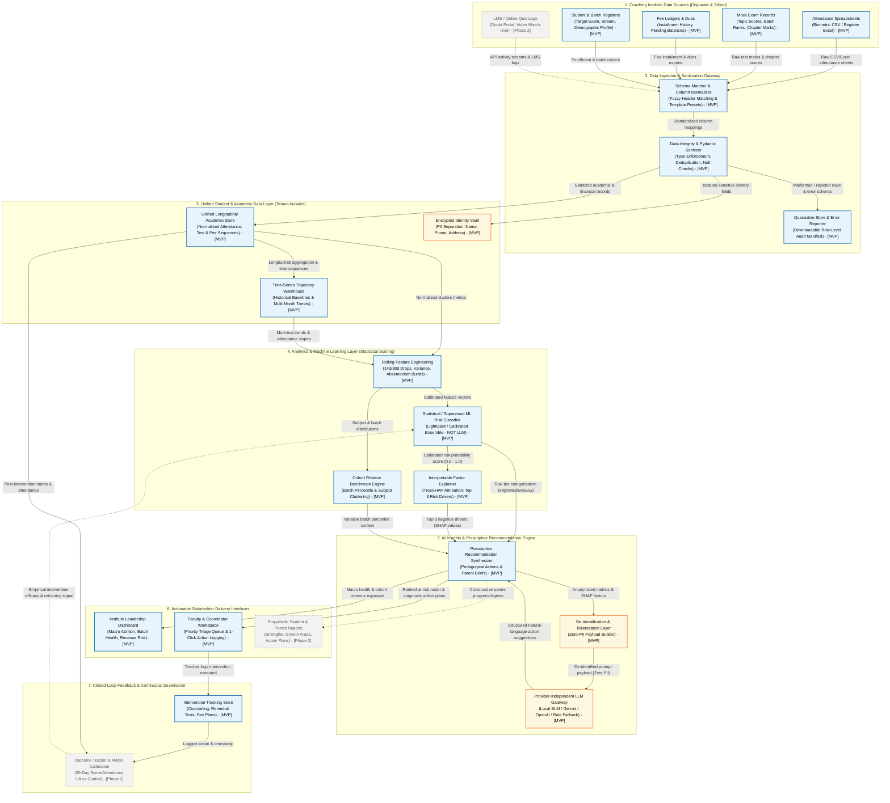
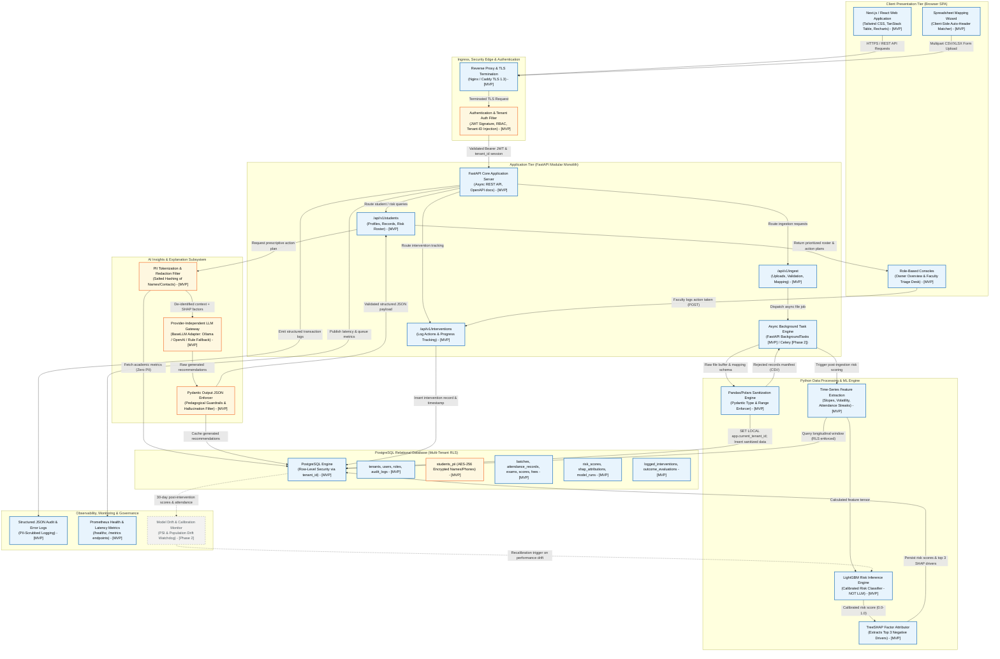

# DataMoat System Architecture: Competition Specification

> **Project**: DataMoat — AI-Powered Intelligence Platform for Coaching Institutes  
> **Document**: System Architecture Specification (Business & Technical Views)  
> **Classification**: Competition Architecture Baseline  
> **Status**: Verified & Validated  

---

## 1. Executive Summary & Architectural Philosophy

Coaching institutes operate in high-stakes, fast-paced academic environments where student retention, exam success (e.g., JEE, NEET, UPSC, SAT, Foundation), and batch profitability determine institutional survival. However, the operational reality of most institutes is defined by **the "Spreadsheet Trap"**: attendance logs, periodic mock test marks, fee installments, and student demographic registers reside in siloed, unstandardized CSV and Excel files.

When institutes seek to modernize, conventional Business Intelligence (BI) dashboards simply visualize lagging indicators—producing colorful charts showing that a student failed an exam three weeks ago or missed 40% of their classes. By the time a chart shows failure, the student has often disengaged, defaulted on fees, or dropped out.

**DataMoat bridges the gap from descriptive visualization to prescriptive intervention.**

```
+---------------------------------------------------------------------------------+
|                              CORE ARCHITECTURAL AXIOM                           |
|                                                                                 |
|  "Statistical ML estimates risk; Generative AI explains and prescribes action."  |
+---------------------------------------------------------------------------------+
```

### Why We Decouple Tabular ML from Generative AI
A critical technical and strategic decision in DataMoat is **not relying on Large Language Models (LLMs) to predict student dropout or academic risk**. Using an LLM directly for risk scoring introduces severe flaws:
1. **Numerical Hallucination & Non-Determinism**: LLMs cannot reliably perform longitudinal statistical slope calculations or compute calibrated probabilities over multi-month tabular time series.
2. **Lack of Calibrated Probability**: High-stakes student interventions require rigorous risk probabilities ($P \in [0.0, 1.0]$) calibrated against real historical cohort dropouts (Brier score minimization), not arbitrary narrative assertions.
3. **Prohibitive Economics & Latency**: Sending raw tabular rows of thousands of students to an LLM context window is cost-prohibitive, slow, and breaches data minimization principles.
4. **Auditability & Explainability**: Decision-makers must know *exactly* why a student was flagged. We use supervised tabular algorithms (**LightGBM / Calibrated Ensemble**) paired with **TreeSHAP** (SHapley Additive exPlanations) for mathematically sound attribution.

The LLM is deployed strictly where it excels: **synthesizing SHAP feature weights and academic context into empathetic, pedagogical, human-actionable recommendations and communication drafts for teachers and parents**, protected behind a strict de-identification boundary.

---

## 2. Architecture View A: High-Level Business Architecture

The Business Architecture illustrates how raw, fragmented data sources from coaching institutes are ingested, normalized, modeled, and translated into stakeholder-specific actions and continuous institutional learning.

### View A Diagram (Mermaid)



### Component Breakdown & Responsibilities (View A)

| Component | Layer | Primary Responsibility | MVP vs Phase 2 |
| :--- | :--- | :--- | :--- |
| **Data Sources** | Ingestion Boundary | Captures disparate CSV/XLSX spreadsheets: biometric attendance, mock tests with chapter breakdowns, fee ledgers, and student profile rosters. | **MVP**: Files<br/>*Phase 2: LMS/Biometric API* |
| **Schema Matcher & Column Normalizer** | Ingestion | Applies fuzzy string matching and regex heuristics to map idiosyncratic institute headers (e.g., `Roll_No`, `Std_ID`, `CandidateID`) to canonical internal entities. | **MVP** |
| **Data Integrity & Pydantic Sanitizer** | Ingestion | Validates data types, date formats, valid mark bounds (0-100%), flags duplicate IDs, and isolates unparseable rows. | **MVP** |
| **Quarantine Store & Error Reporter** | Ingestion | Quarantines malformed rows and generates a downloadable CSV error manifest indicating exact row numbers and validation failure reasons. | **MVP** |
| **Unified Student Academic Store** | Core Data | Stores normalized, multi-tenant relational records linking student academic and operational sequences under a tenant boundary. | **MVP** |
| **Encrypted Identity Vault** | Core Data / Security | Isolates Personally Identifiable Information (PII) like student names, parent phone numbers, and addresses with AES-256 encryption. | **MVP** |
| **Rolling Feature Engineering** | Analytics & ML | Extracts longitudinal features: 14-day attendance rate of change (slope), mock test score variance, subject drop deltas, and fee delay intervals. | **MVP** |
| **Supervised ML Risk Classifier** | Analytics & ML | Runs a trained LightGBM / Calibrated Classifier to compute an objective probability score ($0.0 \le P \le 1.0$) of student dropout or academic failure. | **MVP** |
| **TreeSHAP Factor Explainer** | Analytics & ML | Performs mathematical attribution to identify the exact top 3 negative drivers contributing to the student's risk score. | **MVP** |
| **De-Identification Boundary** | AI Subsystem | Strips all student PII, converting student identities into temporary anonymized tokens (e.g., `Candidate #481`) before interacting with the LLM. | **MVP** |
| **Provider-Independent LLM Gateway** | AI Subsystem | Abstracts LLM execution via an adapter pattern, supporting local models (Ollama), cloud APIs (Gemini/OpenAI), and a deterministic rule-based fallback. | **MVP** |
| **Prescriptive Recommendation Synthesizer** | AI Subsystem | Assembles SHAP factors into concrete pedagogical interventions (e.g., assigned remedial topic, mentor check-in prompt). | **MVP** |
| **Leadership Dashboard** | Stakeholder Delivery | Gives institute owners and directors a high-level view of cohort retention risk, batch-level academic health, and revenue at risk from potential dropouts. | **MVP** |
| **Faculty & Coordinator Workspace** | Stakeholder Delivery | Delivers a prioritized triage queue of at-risk students, root cause diagnostic breakdowns, and 1-click intervention logging. | **MVP** |
| **Automated Parent & Student Reports** | Stakeholder Delivery | Generates constructive, encouraging progress cards focusing on strengths, growth areas, and scheduled remedial support. | *Phase 2* (Manual PDF export in MVP) |
| **Intervention Tracking Store** | Feedback Loop | Captures timestamped records of actions taken by faculty (e.g., counseling session held, homework extension given, concept test scheduled). | **MVP** |
| **Outcome Tracker & Model Calibration** | Feedback Loop | Compares student trajectories 30 days post-intervention against predicted baselines to evaluate intervention efficacy and trigger ML retraining. | *Phase 2* |

---

## 3. Architecture View B: Technical Deployment Architecture

The Technical Deployment Architecture details the software engineering specifications, network boundaries, container topology, database schemas, and security controls that power DataMoat.

### View B Diagram (Mermaid)



---

## 4. End-to-End Data Flow: From Spreadsheet Upload to Actionable Intervention

To demonstrate how the architecture functions in production, the following sequence diagram details the end-to-end lifecycle of an institute coordinator uploading an attendance and mock exam sheet, through model inference, LLM explanation, teacher action, and closed-loop evaluation.

### End-to-End Sequence Diagram (Mermaid)

```mermaid
sequenceDiagram
    autonumber
    actor Staff as Institute Staff / Faculty
    participant FE as Next.js Web Frontend
    participant API as FastAPI Gateway (Auth & RLS)
    participant Worker as Background Task / ETL
    participant DB as PostgreSQL (Multi-Tenant RLS)
    participant ML as ML Risk Engine (LightGBM + SHAP)
    participant LLM as Provider-Agnostic LLM Gateway
    actor Director as Institute Director / Counselor

    %% Phase 1: Ingestion & Validation
    Note over Staff,DB: Phase 1: Ingestion, Validation & Tenant Isolation
    Staff->>FE: Upload attendance/mock exam spreadsheets (CSV/XLSX)
    FE->>API: POST /api/v1/ingest/upload (Multipart + Bearer JWT)
    API->>API: Verify JWT, extract tenant_id, enforce RBAC
    API->>Worker: Dispatch asynchronous processing job (file_buffer, tenant_id)
    API-->>FE: HTTP 202 Accepted (job_id: uuid)
    Worker->>Worker: Map column headers & run Pydantic validations
    alt Malformed Rows Detected
        Worker->>DB: Save rejected rows in quarantine manifest (tenant-isolated)
    end
    Worker->>DB: SET LOCAL app.current_tenant_id; Bulk INSERT valid records

    %% Phase 2: Feature Engineering & Statistical ML Scoring
    Note over Worker,ML: Phase 2: Statistical Risk Estimation (No LLM for Prediction)
    Worker->>ML: Trigger risk inference pipeline for affected batch
    ML->>DB: Query longitudinal 30-day window (attendance, test scores, fee status)
    ML->>ML: Compute features (14d attendance slope, score delta, subject variance)
    ML->>ML: Execute calibrated LightGBM classifier -> risk_probability (0.0 - 1.0)
    ML->>ML: Compute TreeSHAP values -> extract Top 3 negative risk drivers
    ML->>DB: Persist risk_tier, risk_probability & SHAP factors in risk_scores table

    %% Phase 3: Prescriptive AI Generation & Delivery
    Note over Staff,LLM: Phase 3: De-identified Prescriptive Explanations
    Director->>FE: View Batch At-Risk Priority Roster
    FE->>API: GET /api/v1/students/at-risk?batch_id=xyz (Bearer JWT)
    API->>DB: Fetch ranked at-risk students (tenant_id filtered)
    API-->>FE: Render prioritized table with risk scores & SHAP badges
    
    Staff->>FE: Click "Generate Action Plan" for at-risk Student
    FE->>API: POST /api/v1/students/{id}/recommendation
    API->>DB: Fetch student subject weaknesses & SHAP factors
    API->>API: Tokenize & mask PII (Student Name -> "Candidate #481")
    API->>LLM: Dispatch de-identified prompt (Metrics + Drivers + Pedagogical template)
    LLM-->>API: Return structured JSON (Diagnostic summary, 3-step action, parent note)
    API->>API: Validate JSON against Pydantic schema guardrails
    API->>DB: Cache generated recommendation in DB
    API-->>FE: Display actionable diagnostic card & talking points

    %% Phase 4: Action Execution & Closed-Loop Evaluation
    Note over Staff,DB: Phase 4: Intervention Logging & Closed-Loop Feedback
    Staff->>FE: Log action ("Conducted 1-on-1 organic chemistry review")
    FE->>API: POST /api/v1/interventions (action_type, notes, student_id)
    API->>DB: Store intervention event in logged_interventions table
    
    Note over DB,ML: 30-Day Follow-Up & Model Evaluation Loop
    DB-->>ML: Aggregate post-intervention attendance & test scores (30-day window)
    ML->>ML: Measure delta (Risk lift vs control group)
    ML->>DB: Record intervention efficacy score & flag concept drift if calibration deviates
```

### Step-by-Step Flow Description

1. **Upload & Header Ingestion**: An academic coordinator uploads an Excel file (`Mock_Exam_3_BatchA.xlsx`). The frontend provides an interactive mapping preview where fuzzy string matching suggests standard column targets (`Student Roll Number` $\rightarrow$ `student_ref_code`, `Physics Marks` $\rightarrow$ `score_physics`).
2. **Asynchronous Ingestion & Quarantine**: The upload is submitted with a Bearer JWT. FastAPI validates authentication, extracts `tenant_id`, and dispatches an asynchronous background task. The Pandas/Polars parser verifies data types and value ranges (e.g., marks between $0$ and $100$). Any malformed row is written to a tenant-isolated quarantine manifest, allowing the coordinator to download an `errors_row_5_12.csv` report. Valid rows are committed into PostgreSQL.
3. **Feature Generation**: The system triggers feature extraction for the affected cohort. Using SQL window functions and Pandas, it calculates longitudinal metrics:
   - Attendance rate of change over the last 14 days ($\Delta \text{Attn}_{14d}$)
   - Mock exam score drop relative to cohort mean ($\Delta \text{Score}_{\text{rel}}$)
   - Fee payment delinquency status ($\text{DaysOverdue}$)
4. **Machine Learning Risk Estimation**: The calibrated LightGBM classifier estimates the probability of student attrition or major academic failure:
   $$\hat{y} = P(\text{AtRisk} \mid \vec{x}) \in [0.0, 1.0]$$
   Students are assigned risk tiers: **Low** ($<0.35$), **Moderate** ($0.35 - 0.65$), or **High** ($>0.65$).
5. **SHAP Factor Extraction**: TreeSHAP computes the marginal contribution of each feature to the risk score:
   $$\text{RiskScore} = \phi_0 + \sum_{i=1}^{M} \phi_i$$
   The top three negative drivers are saved (e.g., `Organic Chemistry drop: -0.28`, `Biometric absenteeism streak: -0.22`, `Fee delay > 20 days: -0.15`).
6. **Prioritized Faculty Triage**: The faculty workspace renders a live triage queue sorted by risk score. Teachers immediately see why the student is flagged via visual badges.
7. **De-Identified Prescriptive Prompting**: When the teacher clicks "Generate Action Plan", DataMoat queries the student's metrics, strips all PII (name, phone, parent details), and issues a structured prompt to the provider-independent LLM adapter:
   ```json
   {
     "candidate_token": "STUDENT_ID_992",
     "target_exam": "NEET 2027",
     "risk_tier": "High (0.82)",
     "primary_shap_factors": [
       "Organic Chemistry mock test scores dropped 28% across last 2 tests",
       "Missed 4 consecutive weekday morning classes (Kinematics & Reaction Mechanisms)",
       "Installment #2 overdue by 18 days"
     ],
     "academic_strengths": "Biology (Botany percentile: 91st)"
   }
   ```
8. **Structured Recommendation & Delivery**: The LLM responds with a strictly validated JSON payload containing:
   - **Diagnostic Root Cause**: Summary of why the student is struggling without punitive language.
   - **Pedagogical Action**: Specific remedial assignments (e.g., 20-question targeted worksheet on Reaction Mechanisms).
   - **Parent Talking Points**: Constructive communication script emphasizing strengths while addressing attendance.
9. **Intervention Logging & Closed Loop**: The teacher logs their completed action in one click. Thirty days later, DataMoat automatically cross-references the student's subsequent attendance and exam scores against historical control trajectories to assess whether the intervention was successful.

---

## 5. Multi-Tenant Isolation, Data Minimisation & Student Privacy

Student educational records are highly sensitive. DataMoat enforces defense-in-depth across storage, computation, and LLM communication.

```
+---------------------------------------------------------------------------------------+
|                               DATA PRIVACY & SECURITY BOUNDARY                        |
|                                                                                       |
|   [Institute Client]  -->  [TLS 1.3]  -->  [FastAPI Auth & Tenant Context]            |
|                                                  |                                    |
|         +----------------------------------------+-------------------------------+    |
|         |                                                                        |    |
|         v                                                                        v    |
|   [PostgreSQL DB]                                                        [LLM Boundary]
|   - Row-Level Security (RLS)                                             - ZERO PII   |
|   - `tenant_id` session parameter                                        - Pseudonym  |
|   - AES-256 for student names & phone numbers                            - Aggregated |
|   - Separate `students_pii` table                                          features   |
+---------------------------------------------------------------------------------------+
```

### 1. PostgreSQL Row-Level Security (RLS)
To prevent cross-tenant data contamination, multi-tenancy is enforced directly at the database engine level via PostgreSQL RLS policies rather than relying purely on application-level filtering.

```sql
-- Enable RLS on core student tables
ALTER TABLE student_records ENABLE ROW LEVEL SECURITY;
ALTER TABLE mock_exam_scores ENABLE ROW LEVEL SECURITY;
ALTER TABLE attendance_logs ENABLE ROW LEVEL SECURITY;

-- Define tenant isolation policy
CREATE POLICY tenant_isolation_policy ON student_records
    FOR ALL
    USING (tenant_id = NULLIF(current_setting('app.current_tenant_id', true), '')::uuid);
```
Every incoming API request sets the local session variable during connection checkout:
```python
# FastAPI Database Dependency
async def get_db_context(tenant_id: UUID = Depends(extract_tenant_from_jwt)):
    async with engine.connect() as conn:
        await conn.execute(text(f"SET LOCAL app.current_tenant_id = '{tenant_id}'"))
        yield conn
```

### 2. Physical Separation of Identity (PII Vault)
Student names, parent contact numbers, and home addresses are stored in a physically segregated `students_pii` table with application-level AES-256-GCM encryption. The analytical tables reference only a salted `student_uuid`. Tutors see names on their private, authenticated dashboard, but the feature engineering and ML training layers consume solely anonymized UUIDs.

### 3. Data Minimisation for Generative AI
Under no circumstances is student PII sent to external LLM providers or local model contexts. The prompt compilation engine strictly adheres to data minimisation:
- Student names are replaced with temporary session tokens (`Candidate #N`).
- Absolute marks are converted to relative cohort percentiles and delta percentages.
- Exact demographic or location information is purged.

### 4. Consent & Data Retention Lifecycle
Institutes configure automated data retention policies:
- Inactive student records are pseudonymized upon cohort graduation.
- Raw CSV upload artifacts are deleted from temporary storage immediately after ingestion and database commit.
- An immutable audit log (`audit_logs`) tracks every user access event, file upload, and report export.

---

## 6. Machine Learning Model Governance & Feedback Loop

### Tabular Model Selection & Calibration
Predicting academic attrition is an imbalanced classification problem. DataMoat utilizes **LightGBM** (Light Gradient Boosting Machine) for the following reasons:
- Superior handling of missing values common in student test spreadsheets.
- Built-in support for categorical features (batch type, target exam, subject stream).
- Fast training times enabling on-premise retraining on standard CPU hardware.
- Probability calibration using **Platt Scaling** or **Isotonic Regression** to ensure predicted probabilities match real empirical risk frequencies.

### Model Evaluation Rubric

$$\text{Brier Score} = \frac{1}{N} \sum_{t=1}^{N} (f_t - o_t)^2$$

Where $f_t$ is the calibrated risk forecast probability and $o_t \in \{0, 1\}$ is the actual student retention outcome.

| Metric | Target Baseline | Rationale |
| :--- | :--- | :--- |
| **Precision @ Top 20%** | $\ge 78\%$ | Prevents "alert fatigue"; faculty only act on students genuinely requiring help. |
| **Recall (At-Risk)** | $\ge 82\%$ | Minimizes undetected student dropouts. |
| **Brier Calibration Score** | $\le 0.12$ | Guarantees reliability of predicted risk probabilities. |
| **Inference Latency** | $< 15\text{ms}$ per batch | Allows instant on-demand calculation following spreadsheet uploads. |

### Model Drift Monitoring & Retraining Loop
Student dynamics shift between examination cycles (e.g., heightened stress before milestone tests). In Phase 2, DataMoat tracks:
- **Population Stability Index (PSI)** on incoming feature distributions:
  $$\text{PSI} = \sum \left( (P_i - Q_i) \times \ln\left(\frac{P_i}{Q_i}\right) \right)$$
  A $\text{PSI} > 0.2$ alerts the administrator to significant cohort shift and initiates model recalibration.
- **Intervention Efficacy Scoring**: When a teacher logs an intervention (e.g., "Assigned mentor counseling"), the system tracks the student's 30-day delta in attendance and test marks. If a specific intervention type consistently fails to alter risk trajectories, the system updates its prescriptive recommendation rules.

---

## 7. Component Responsibilities & Implementation Phasing

| Subsystem | Component | MVP Specification (Prototype / Competition) | Phase 2 / Enterprise Roadmap |
| :--- | :--- | :--- | :--- |
| **Frontend** | Application Shell | **Next.js 14 / React SPA** with Tailwind CSS & Shadcn UI. Fast, accessible, and responsive. | Mobile Application (React Native) for coaches on the move. |
| **Frontend** | Ingestion Wizard | Drag-and-drop CSV/XLSX uploader with client-side header matching dropdowns. | Automated OCR for scanned physical attendance sheets. |
| **Frontend** | Risk Visualization | Recharts waterfall for SHAP drivers, tabular triage data grid with filterable risk tiers. | Interactive cohort heatmaps and student journey graphs. |
| **Backend API** | Application Server | **FastAPI (Python 3.11+)** modular monolith with async endpoints and Pydantic validation. | Distributed microservices (if tenant count exceeds 500+). |
| **Backend API** | Auth & RBAC | JWT Bearer tokens with Role-Based Access Control (`Owner`, `Coordinator`, `Teacher`). | Single Sign-On (SSO) with Google Workspace / Active Directory. |
| **Worker / Queue** | Task Execution | **FastAPI BackgroundTasks** (in-process, zero external infrastructure dependency). | **Celery + Redis** for distributed multi-worker task execution. |
| **Database** | Relational Store | **PostgreSQL 16** with Row-Level Security (RLS) for tenant isolation. | Multi-region read replicas with automated point-in-time recovery. |
| **ML Engine** | Risk Inference | **LightGBM / Scikit-learn** model executed locally in Python runtime. | Automated hyperparameter tuning and custom per-institute models. |
| **ML Engine** | Explainability | **TreeSHAP** library generating local feature attributions per student. | Integrated Global Cohort SHAP & Counterfactual Explanations. |
| **AI Explanation** | LLM Gateway | **Provider-Agnostic Adapter** with LiteLLM/Local Ollama/Cloud API & Deterministic Rule fallback. | Fine-tuned Small Language Model (SLM, e.g. Llama 3 8B) hosted on dedicated hardware. |
| **Delivery** | Parent Reporting | On-demand **PDF generation** (Weasyprint / ReportLab) downloadable by coordinators. | Automated WhatsApp Business API delivery directly to parent devices. |
| **Governance** | Model Drift | Manual periodic evaluation script logging F1 & Brier score. | Automated continuous drift monitoring via Evidently AI. |

---

## 8. Summary: Architectural Defensibility

DataMoat's architectural moat lies in the convergence of three foundational pillars:
1. **Low Friction Ingestion**: Embracing the reality of coaching institutes' spreadsheet workflows rather than forcing them onto disruptive, complex ERPs.
2. **Methodological Rigor**: Using calibrated, interpretable tabular machine learning for prediction, preventing the hallucination and trust issues inherent in raw LLM scoring.
3. **Actionable Prescriptions with Zero PII Exposure**: Deploying Generative AI strictly as an empathetic explanation layer behind an impenetrable de-identification and tenant isolation boundary.
